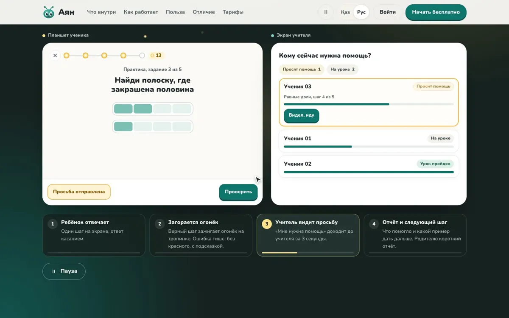
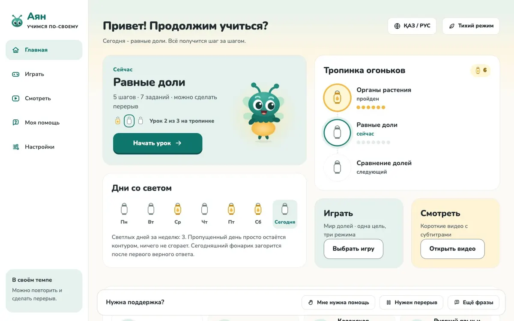
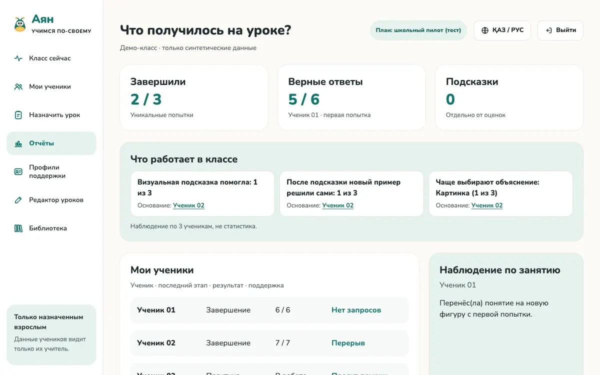
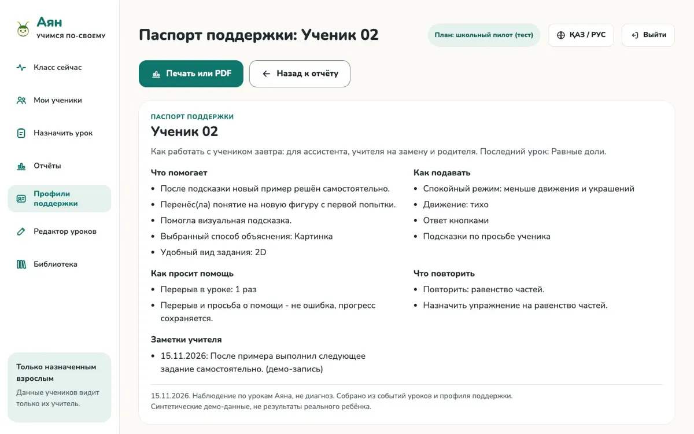
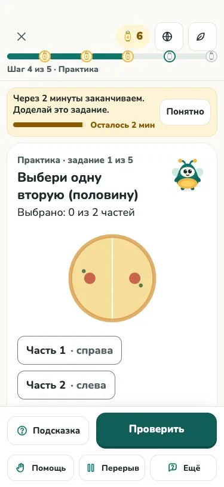
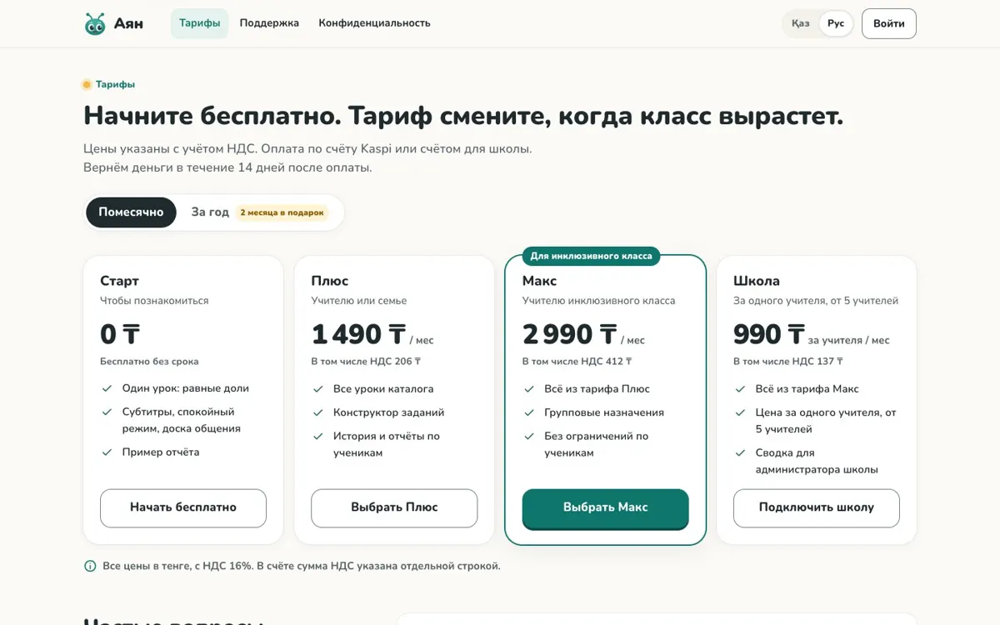

# Аян

Платформа для инклюзивного класса: ребёнок с особыми потребностями проходит урок своим путём, а учитель сразу видит, кому нужна помощь.

Сайт: https://ayan-learning.vercel.app

---

## Проблема

- **94 527 детей** с особыми образовательными потребностями учатся в инклюзивной среде, то есть в обычных школах. Источник: Минпросвещения РК, [bizmedia.kz, 12.01.2026](https://bizmedia.kz/2026-01-12-minprosveshheniya-rk-usilivaet-razvitie-inklyuzivnogo-obrazovaniya/).
- **95,2% школ** «создали условия» для инклюзии. Это формальный критерий (пандус, кабинет), а не качество урока. Источник: [gov.kz, 04.05.2025](https://www.gov.kz/memleket/entities/edu/press/news/details/988902?lang=ru); bizmedia.kz, итоги 2025.
- **12 центров аутизма** на всю страну. Источник: тот же материал bizmedia.kz.

Ребёнок уже в классе, а урок остался прежним: один план на 25 детей и один учитель. Если ребёнку трудно, учитель узнаёт об этом поздно.

## Решение

Один урок по программе РК на казахском и русском, который каждый ребёнок проходит своим способом:

- **Ребёнок** видит на экране один шаг. Объяснение подаётся пятью способами (текст, картинка, аудио, видео, модель), подсказки даются в три уровня. Кнопки «Мне нужна помощь» и «Нужен перерыв» всегда под рукой. Тихий режим выключает всё движение.
- **Учитель** назначает готовый урок и видит живой пульс класса: кто на каком шаге, кто попросил помощь или перерыв. После урока он видит не оценку, а то, что помогло.
- **Родитель** получает короткий отчёт о том, что повторить дома.

Мы не лечим и не ставим диагнозов. Аян - инструмент наблюдения и поддержки на уроке.

## Что уже работает

| | |
|---|---|
|  | **Живой пульс класса.** Ребёнок нажимает «Мне нужна помощь», и учитель видит это за несколько секунд, без перезагрузки страницы. |
|  | **Главная ребёнка.** Тропинка огоньков с уроками, «Дни со светом» без наказания за пропуск, видео и игра по теме. |
|  | **Отчёт «что помогло».** Учитель видит первую попытку, решение после подсказки и новый пример, а также закономерности по классу. |
|  | **Паспорт поддержки.** Одна страница для ассистента, учителя на замене и родителя: что помогает ребёнку и как он просит помощь. Её можно напечатать или сохранить в PDF. |
|  | **«Скоро заканчиваем».** Учитель заранее предупреждает класс, а ребёнок видит спокойную шкалу времени вместо резкого звонка. |
|  | **Аккаунты и тарифы.** Регистрация учителя, родителя и школы, онбординг, тарифы, оформление подписки со счётом. Приём платежей пока работает в режиме имитации, данные карты не запрашиваются. |

Ещё в продукте:
- шесть уроков на казахском и русском (математика, биология, информатика);
- каталог из восьми предметов 5-6 классов;
- видеоурок с субтитрами и тихой версией;
- «Сначала - потом»: ребёнок сам выбирает, что будет после урока;
- ответы детей проверяются на сервере по правилам;
- права доступа и офлайн-очередь ответов.

## Как попробовать

1. Откройте https://ayan-learning.vercel.app
2. Нажмите «Войти».
3. Логин и пароль выдаются жюри отдельно.

## Видео

Видео: будет добавлено.

<!-- VIDEO -->

## Презентация

Презентация: будет добавлена.

<!-- SLIDES -->

## Технологии

- Node.js 24, собственный HTTP-сервер (`server.mjs`), статический фронтенд на ES-модулях (`dist/`) без сборщика.
- Авторизация: better-auth.
- База: PostgreSQL в продакшене (через `DATABASE_URL`), SQLite (`node:sqlite`) локально.
- ИИ-черновик урока для учителя: AI SDK + Groq. Без ключа используются заготовки. Ответы детей ИИ не проверяет.
- Маскот: SVG-риг и Web Animations API, в тихом режиме анимаций нет.
- Хостинг: Vercel.

## Запуск локально

```bash
npm install
npm start              # http://127.0.0.1:4183 (порт задаётся переменной PORT)
npm run demo           # тестовые данные, порт 4300
```

Тесты:

```bash
npm test               # юнит-тесты
npm run test:access    # матрица прав доступа
npm run test:e2e       # браузерные сценарии
npm run test:accounts  # аккаунты, тарифы, подписка
```

Без `DATABASE_URL` сервер работает на локальной SQLite. Ключи и секреты в репозиторий не кладутся.

## Безопасность и данные детей

- **Согласие родителей.** Ученика можно добавить только с согласием родителя на обработку данных ребёнка. Условия, политика конфиденциальности и согласие опубликованы на сайте (страницы `/legal/...`).
- **Без диагнозов.** Аян не собирает диагнозы и не ставит ярлыков. В анкете отмечаются только потребности в поддержке. Отчёты подписаны как «наблюдение, не диагноз».
- **Без рекламы.** В продукте нет рекламы, и данные детей не передаются третьим лицам для рекламы.
- **Ребёнку не нужна почта.** Ученик входит по коду от учителя. Данные ученика видит только его учитель.
- **ИИ ничего не публикует сам.** Черновик урока проверяет взрослый.
- Пользователь может выгрузить свои данные и удалить аккаунт.

## Дорожная карта

1. **Пилот, 1-3 месяц:** 3-5 школ и 1-2 центра, бесплатно. Измеряем, сам ли ребёнок завершает урок, решает ли новый пример после подсказки и как быстро учитель отвечает на просьбу о помощи.
2. **Проверка контента:** уроки проверяют методист, дефектолог и носитель казахского языка.
3. **Год 1:** договор с одной областью, математика 1-4 классов и казахский язык, игры по предметам (сейчас это концепт).
4. **Год 3:** 2-3 области, узбекский и кыргызский языки, выход в Центральную Азию с партнёром.

Честно о стадии: продукт работает, реальных пользователей пока нет. Эффект для ребёнка мы проверим в пилоте.
