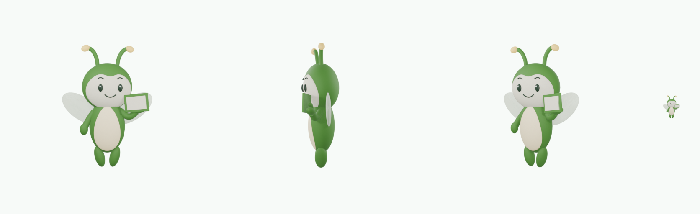
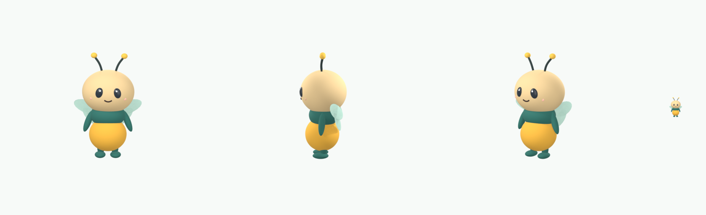
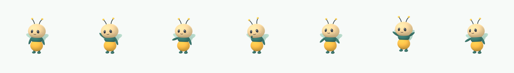
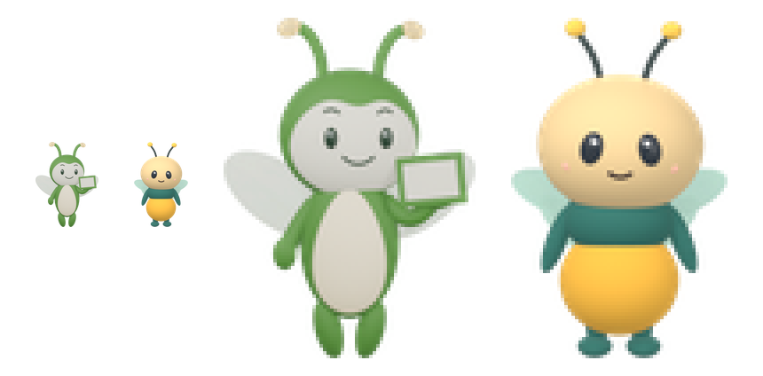

# Маскот Аян: ревью и новая модель

Дата: 13.11.2026. Требования: `docs/briefs/edtech-v2-claude/requirements/MASCOT_REDESIGN_AND_UI.md`. Концепт-направление: `docs/briefs/edtech-v2-claude/design-references/mascot-concept/01-firefly-blender-reference.png`.

## 1. Текущий светлячок (до замены)

Источник: `dist/assets/ayan/ayan.glb` (из `assets-src/ayan.blend`). Кадры сняты импортом GLB в чистую сцену Blender 5.3, без правок модели.

Файлы: `mascot-review/current-front.png`, `current-side.png`, `current-three-quarter.png`, `current-96px-tall.png` (персонаж высотой 96 px).

| Что проверял | Наблюдение (по кадрам) | Исправление в новой модели |
|---|---|---|
| Силуэт | Голова и тело одного зелёного цвета сливаются в одно «зерно»; в 96 px читается как зелёное пятно с белым животом. | Три различимых объёма: бежевая голова, бирюзовый торс, медовое брюшко. |
| Лицо | Светлое лицо вставлено в зелёный «капюшон»: выглядит как маска. Глаза маленькие и близко. | Лицо - сама голова; крупные глаза с бликом, маленький рот, мягкие щёки. |
| Мимика | Высоко поднятые брови дают постоянное удивление. | Брови убраны, нейтральная спокойная улыбка. |
| Пропорции | Голова около 30% роста, ноги-«фасолины» без стоп: стойка неустойчивая, персонаж висит. | Голова около 40% роста (детская пропорция), короткие ноги с округлыми стопами, стоит на плоскости. |
| Реквизит | Карточка в руке во всех позах, включая покой. | Без постоянного реквизита: руки свободны для жестов. |
| Материалы и свет | Насыщенный листовой зелёный (#3f7a2a), «светящееся» кремовое брюхо: не совпадает с новой палитрой, светлячок узнаётся слабо. | Матовые материалы палитры V2.1: голова #E6C792, торс #2F6F65, брюшко #F4B740. Свечение и bloom не используются. |
| Крылья | Крупные молочные плоскости; сбоку видны как тонкие пластины. | Две пары узких полупрозрачных мятных крыльев за спиной, в покое почти неподвижны. |
| Геометрия | 44 284 треугольника (выше проектного бюджета 30k). | 16 784 треугольника. |
| Анимация | 19 клипов под прежние события (полёт, сад, кручение); нет клипов Thinking/Helping в понимании V2. | Ровно семь состояний V2: Idle, Greeting, Explaining, Thinking, Encouraging, Celebrating, Helping. |

Дефекты рига и геометрии, которых не видно на кадрах, здесь не заявляются.

## 2. Новая модель

- **Построение:** `assets-src/firefly_build.py` строит модель с нуля в Blender (части, материалы, арматура, клипы), сохраняет `.blend`, экспортирует GLB и рендерит кадры. Запуск: `/Applications/Blender.app/Contents/MacOS/Blender -b -P assets-src/firefly_build.py`, затем `python assets-src/crop_stills.py`.
- **Части:** голова, торс, брюшко, две ноги со стопами, две руки, две пары крыльев, усики с медовыми кончиками, глаза с бликами, рот, щёки. Каждая часть - отдельный mesh с общей шкалой (метры), origin персонажа в точке между стопами.
- **Риг:** простая иерархия костей `root → body → head`, `arm.L/R`, `wing.L/R`, `antenna.L/R`, `eye.L/R`, `mouth`. Части жёстко привязаны к костям (без скиннинга), поэтому в glTF нет деформаций и артефактов весов. Каждый клип ключует все кости на первом и последнем кадре, поэтому клипы не наследуют позу друг друга.
- **Клипы (30 fps):** Idle 120 к. (цикл: дыхание, лёгкий наклон головы, одно моргание), Greeting 60 к. (взмах рукой), Explaining 90 к. (цикл: открытая ладонь к заданию), Thinking 90 к. (цикл: рука у подбородка, взгляд вверх), Encouraging 48 к. (два спокойных кивка), Celebrating 54 к. (небольшой прыжок, руки вверх, без конфетти и звука), Helping 90 к. (цикл: наклон и указание вниз-влево, к заданию).
- **Спокойный режим и reduced motion:** вместо 3D показывается статичный PNG того же персонажа в нужном состоянии (`dist/assets/mascot/stills/<State>.png`), поэтому крылья и усики неподвижны. Без WebGL и при ошибке загрузки GLB - тот же PNG. Скрытый маскот не оставляет пустого места, подсказки остаются текстом.

### Файлы и размеры

| Файл | Размер |
|---|---|
| `assets-src/firefly.blend` | 280 КБ |
| `assets-src/firefly_build.py`, `assets-src/firefly_check.py`, `assets-src/crop_stills.py` | скрипты |
| `dist/assets/mascot/firefly.glb` | 385 КБ (бюджет 2 МБ), 16 784 треугольника (бюджет 30k), 24 mesh, 11 материалов, 7 анимаций |
| `dist/assets/mascot/stills/*.png` | 7 файлов, 512×512, прозрачный фон, общий масштаб, всего 924 КБ |
| `docs/mascot-review/new-front.png`, `new-side.png`, `new-three-quarter.png`, `new-96px-tall.png` | рендер-лист |

### Выполненные проверки

| ID | Проверка | Результат |
|---|---|---|
| MASCOT2-01 | Ревью текущего персонажа по реальным кадрам | Готово, раздел 1 |
| MASCOT2-02 | `.blend` открыт в Blender 5.3 (арматура + 24 детали); GLB импортирован в пустую сцену скриптом `firefly_check.py` | Высота 2,50 м, стопы на z=0, 11 материалов, 7 анимаций, крылья в режиме BLEND |
| MASCOT2-03 | Сравнение front/side/three-quarter и 96 px | Один персонаж во всех ракурсах; в 96 px читаются глаза, блик и улыбка (см. `compare-96px.png`) |
| MASCOT2-04 | Переключение семи состояний | Клипы загружаются в Three.js (страница «Твой помощник»), переключаются с плавным переходом 0,25 с; одноразовые клипы возвращаются в Idle |
| MASCOT2-05 | Reduced motion, скрытие, голос выключен, WebGL нет | Статичный PNG того же состояния; скрытие убирает блок без пустого места; голос по умолчанию выключен |

### Ограничения

- Мимика ограничена позами, морганием и взглядом (морф-таргетов рта нет). Для 96 px этого достаточно; выражения из концепта (смех, удивлённый рот) не сделаны.
- Освещение в Three.js проще, чем в рендере Blender: в браузере голова чуть темнее, чем на PNG. На размер карточки это не влияет.
- Прежняя модель `dist/assets/ayan/ayan.glb` оставлена только для классического кабинета (`/child/classic`). Видеоурок M01 0.2.0 уже с новым светлячком (кадры: `assets-src/render_firefly_frames.py`).
