# Визуальная приёмка V2.1

Эталон: `docs/briefs/edtech-v2-claude/ui-mockups/` (13 PNG), правила: `DESIGN_SYSTEM.md` §11. Скриншоты сняты автоматически сценарием `tests/v2-e2e.cjs` (Chrome headless, 1440×1024 и 390×844, масштаб 100%, RU, синтетические данные демо-режима, локальный шрифт Nunito). Слева макет, справа реализация.

Это не заявление о pixel-perfect и не сертификат WCAG: ниже то, что проверено, и то, что отличается.

## Замер сетки (автоматически, VIS-01)

| Параметр | Эталон | Реализация |
|---|---|---|
| Боковая навигация | 248 px | 248 px |
| Начало контента | x = 288 | x = 288 |
| Шаги маршрута | 5 × 196×70, x = 288/504/720/936/1152 | 5 × 196×75, x = 288/504/720/936/1152 |
| Высота кнопки | 56 px | 56 px |
| Радиус карточки | 24 px | 24 px |
| H1 | 31-32 px | 32 px |

Шаги на 5 px выше эталона: номер и название этапа в две строки при шрифте 16/18 px не помещаются в 70 px без уменьшения текста. Допуск ±8 px соблюдён.

## Экраны

| Макет | Сравнение | Совпадает | Отличия и почему |
|---|---|---|---|
| 01 главная ребёнка | 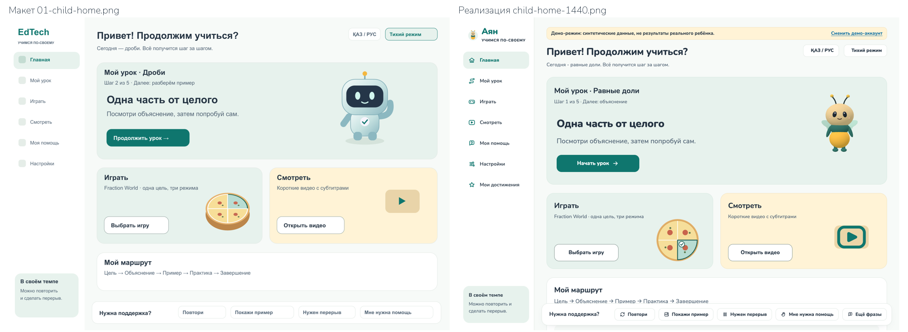 | Сайдбар, приветствие, карточка урока с маскотом, «Играть»/«Смотреть», «Мой маршрут», панель поддержки | Маскот - новый светлячок вместо робота (требование V2.1). Добавлена плашка «Демо-режим» (обязательна для синтетических данных). В панели поддержки пятая кнопка «Ещё фразы», чтобы все 7 фраз были доступны одним действием. |
| 02 маршрут, пример | 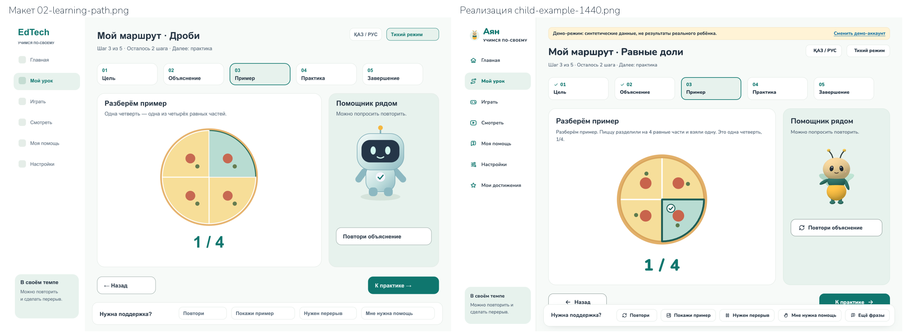 | 5 шагов, текущий выделен рамкой и `aria-current`, «Разберём пример», круг 1/4, «Помощник рядом», «Повтори объяснение», Назад / К практике | Пройденные шаги отмечены галочкой (в макете только текущий). |
| 03 Fraction World 3D | 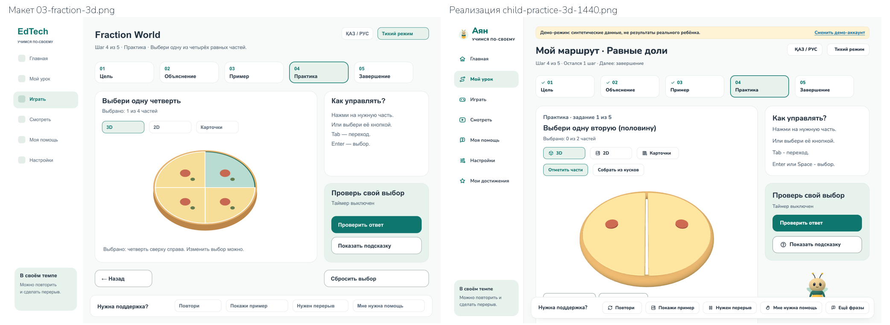 | Вкладки 3D/2D/Карточки, «Выбрано: n из m», «Как управлять?», «Проверь свой выбор», «Таймер выключен», «Сбросить выбор» | Добавлен переключатель способа ответа «Отметить части / Собрать из кусков» (V2.1 §1). Под сценой всегда есть DOM-кнопки частей, canvas не единственный способ. 3D строится процедурно из геометрии задания. |
| 04 Fraction World 2D | 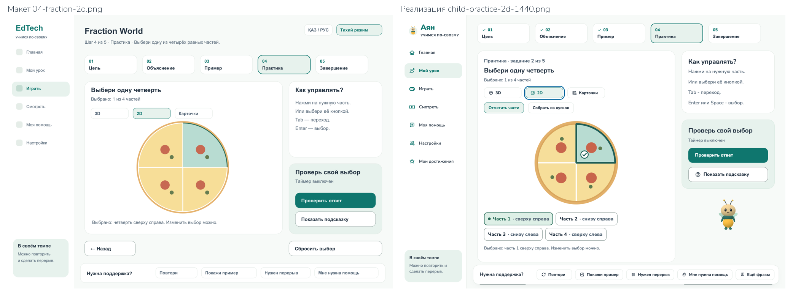 | Та же цель, вид сверху, выбранная часть с контуром и галочкой | - |
| 05 карточки | 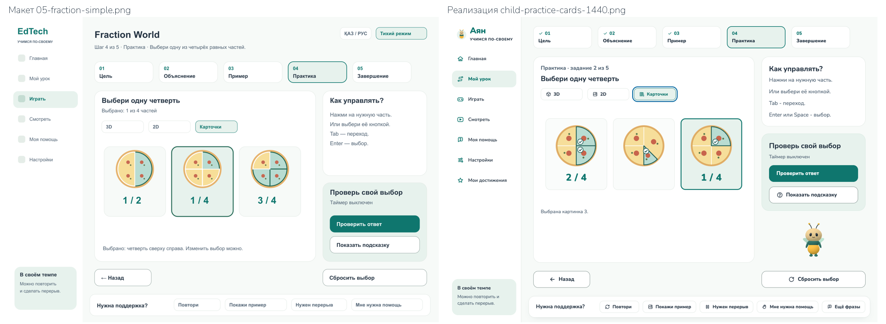 | Три карточки, выбранная с рамкой 3 px | Одна карточка намеренно с неравными частями (без числа), чтобы выбор не сводился к подсчёту. |
| 06 маскот | 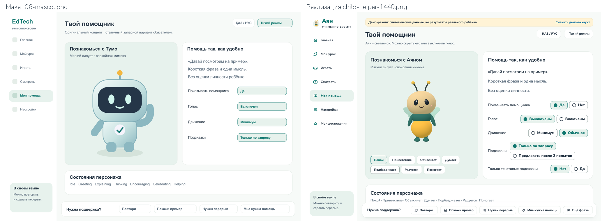 | Персонаж слева, «Помощь так, как удобно», настройки показа, голоса, движения, подсказок | Переключатели - явные пары «Да/Нет», «Минимум/Обычное». Добавлены кнопки семи состояний для проверки клипов. |
| 07 настройки | 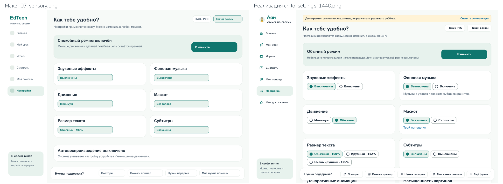 | Карточка режима с «Изменить», двухколоночная сетка настроек, блок про автовоспроизведение | Настроек больше, чем в макете: ТЗ требует полный список (декоративные анимации, насыщенность, сложность, таймеры, скорость озвучки). |
| 08 видео | 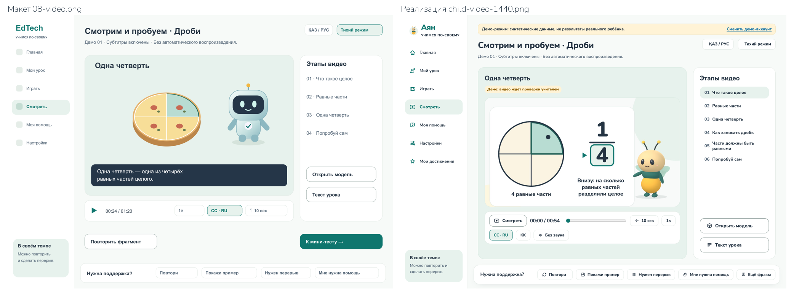 | Заголовок, видео с субтитрами на тёмной плашке, «Этапы видео», «Открыть модель», «Текст урока», «Повторить фрагмент», «К мини-тесту» | Ролик 0.2.0 с новым светлячком; камера в ролике плавно движется (пожелание владельца), для спокойного режима плеер берёт версию с неподвижной камерой. Контролы в две строки из-за дополнительных кнопок языка и звука. |
| 09 помощь | 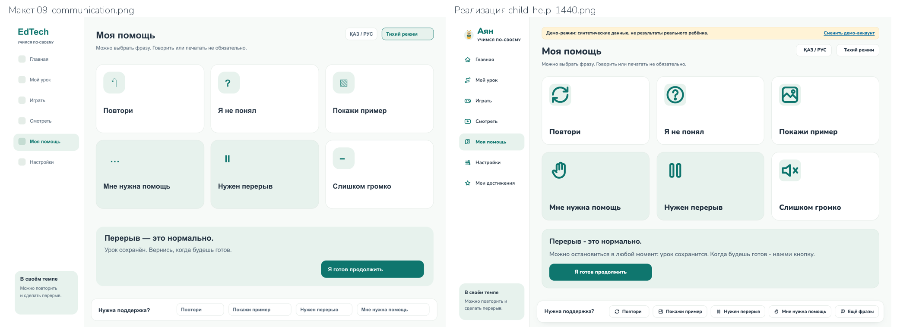 | 6 карточек фраз, панель «Перерыв - это нормально» с «Я готов продолжить» | Иконки - один нарисованный набор вместо условных символов макета. |
| 10 форматы объяснения | 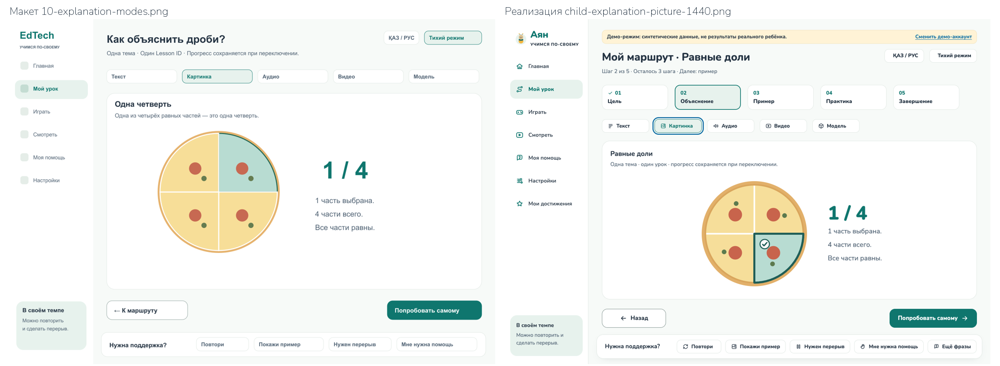 | Вкладки Текст/Картинка/Аудио/Видео/Модель, пицца с выделенной четвертью, «1 / 4», три факта, «К маршруту» / «Попробовать самому» | Вкладки - настоящие `tablist` со стрелками. |
| 11 отчёт учителя | 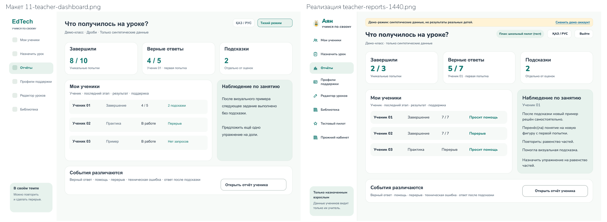 | Три карточки (завершили, верные ответы, подсказки), «Мои ученики» с этапом/результатом/поддержкой, «Наблюдение по занятию», «События различаются» | Цифры из реальных событий демо-базы, не из макета. |
| 12 профиль поддержки | 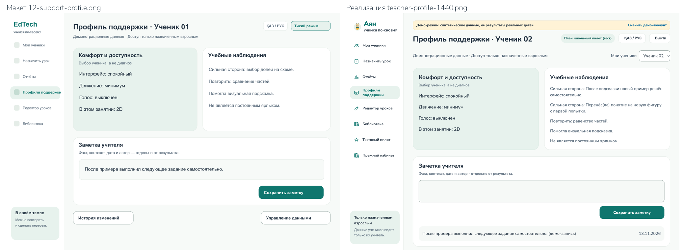 | «Комфорт и доступность», «Учебные наблюдения», «Заметка учителя», «История изменений», «Управление данными» | Добавлены выбор ученика и настройка фраз панели коммуникации. |
| 13 мобильный | 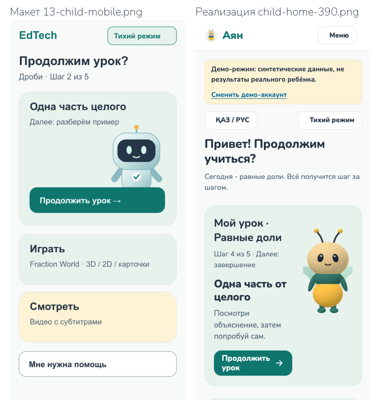 | Одна колонка, карточка урока с маскотом и «Продолжить урок», «Играть», «Смотреть», «Мне нужна помощь» | Навигация через кнопку «Меню». Переключатели языка и тихого режима - строкой под шапкой. Панель поддержки на мобильном идёт в обычном потоке, а не закреплена, чтобы не перекрывать урок. |

Другие экраны: `visual-qa/child-first-visit-1440.png` (выбор режима при первом входе), `child-explanation-picture-1440.png`, `child-complete-1440.png`, `child-lesson-320.png`, `teacher-report-student-1440.png`, `teacher-editor-1440.png` (конструктор и preview), `teacher-assign-1440.png`.

## Доступность (автоматически, tests/v2-e2e.cjs)

| ID | Проверка | Результат |
|---|---|---|
| A11Y-01 | Tab доходит до «Начать урок», кольцо фокуса 3 px #0369A1; урок пройден клавиатурой (Enter/Space/стрелки/Escape) | PASS |
| A11Y-03 | 390 px, 320 px и масштаб 200% (720 CSS px при DPR 2): главная, урок, помощь, настройки без горизонтальной прокрутки, помощь доступна | PASS |
| SENS-03 | Системное «уменьшение движения»: декоративное движение выключено, маскот - статичный кадр | PASS |
| GAME-04 | Нет WebGL: то же задание в 2D, понятное сообщение, выбор сохранён | PASS |
| LOCAL-03 | Браузер не обращался ни к одному адресу кроме localhost | PASS |
| VIDEO-01 | Видео не стартует само, субтитры включены | PASS |
| VIDEO | Обычный режим получает ролик с камерой, «уменьшение движения» - версию с неподвижной камерой | PASS |

## Не проверено автоматически

- Скринридер (VoiceOver/NVDA): разметка сделана под него (роли, `aria-current="step"`, live-регионы, подписи кнопок), но живой прогон не выполнялся.
- Контраст посчитан по парам токенов (формула WCAG), а не измерителем на каждом состоянии в браузере:

| Пара | Контраст |
|---|---|
| Основной текст #243342 на белом / на фоне #F7FAF8 | 12.9 / 12.3 |
| Вторичный #526475 на белом / фоне / мяте / песке | 6.1 / 5.8 / 5.3 / 5.5 |
| Белый на primary #0F766E / hover #115E59 | 5.5 / 7.6 |
| Primary на мяте (выбранный чип) | 4.8 |
| Успех, ошибка, «попробуй ещё», info на своих фонах | 5.4 / 5.8 / 7.6 / 6.6 |
| Фокус #0369A1 на белом / фоне | 5.9 / 5.7 |
| Disabled #646276 на #ECEAF1 | 5.0 |
| Контур контролов | токен #879A96 даёт 2.96:1 на белом (ниже 3:1), поэтому в реализации #728581: 3.9 на белом, 3.4 на мяте |
- Длинные казахские подписи на 320 px проверены только для главной и урока.
